<div align="center">

# Nook ●
### Autonomous AI Coworkers with Persistent Computers & Living Spaces

[](LICENSE)
[](https://nextjs.org/)
[](https://react.dev/)
[](https://www.typescriptlang.org/)
[](https://nodejs.org/)
[](https://modelcontextprotocol.io/)
[](README.md)
[](CONTRIBUTING.md)

<p align="center">
  <b>A self-hosted, single-user workspace for persistent AI coworkers.</b><br/>
  Featuring dedicated execution sandboxes, server-side approval gates, durable SQLite state, living spaces, and Model Context Protocol (MCP) tool calling.<br/>
  <i>Developed through human-directed, AI-assisted "vibe coding" with high craft and rigorous security remediation.</i>
</p>

[Quickstart](#-quickstart) • [Architecture](#-architecture) • [Security & Isolation](#-security--isolation-model) • [Feature Matrix](#-feature-matrix--status) • [Roadmap](ROADMAP.md) • [Contributing](CONTRIBUTING.md)

</div>

---

> [!NOTE]
> **✨ Methodology Disclosure**: Nook was created and developed through human-directed AI-assisted development ("vibe coding"). Every subsystem has undergone technical auditing, security remediation, and verification across authentication, server approvals, isolation boundaries, SSRF prevention, and transactional persistence.

## 🌟 Overview

**Nook** provides a dedicated, single-user operating environment for AI coworkers. Rather than disposable, stateless chat threads, Nook pairs each coworker with:
- **Persistent Persona & Role**: Scout (Research), Quill (Technical Writing), Cipher (DevOps & Code), and Aura (Architecture & Strategy).
- **Predefined Mission Orchestration**: Multi-milestone goals orchestrated through a deterministic coworker workflow (Scout for research & verified citations -> Quill for technical drafting -> Cipher for code synthesis, testing, and sandbox execution). Dynamic solution synthesis is powered directly by Anthropic Claude 3.5 Sonnet, Google Gemini, OpenAI, or local Ollama.
- **Immutable Evidence Engine**: Every agent action creates an inspectable execution record with tool inputs, citations, command exit codes, and output artifacts.
- **Agent Computer**: An execution environment with shell execution, file synchronization, and web browsing.
- **Living Spaces**: Markdown canvas with version tracking, immutable revision logs, full-text search, and document rollbacks.
- **Human-in-the-Loop Governance**: Strict separation of machine vs. human credentials (`NOOK_APPROVER_PASSWORD` distinct from machine API keys), requiring single-use human cryptographic approval before executing mutating actions.
- **100% Sovereign & Self-Hostable**: Complete offline-first execution with local Ollama model integration and full v2 workspace snapshot export/import (retaining spaces, documents, revision history, missions, tasks, and evidence).

---

## 🏗️ Architecture

```mermaid
graph TD
  User([Authenticated Human Approver]) <-->|Approver Session / NOOK_APPROVER_PASSWORD| Gateway[Next.js App & Security Middleware]
  Agent([Machine / Coworker Client]) <-->|API Key / NOOK_API_KEY| Gateway
  
  subgraph Frontend [Client Workspace]
    Gateway <--> UI[Nook Desktop Interface]
    UI <--> Chat[Coworker Chat & Review Cards]
    UI <--> Missions[Missions & Milestone Tracker]
    UI <--> Spaces[Living Spaces Editor & Revisions]
    UI <--> Computer[Agent Computer Modal]
  end

  subgraph BackendEngine [Security & Execution Services]
    Gateway <--> AuthRoute[/api/auth/session - Human & Machine Auth/]
    Gateway <--> MissionRoute[/api/missions - Aura Orchestrator/]
    Gateway <--> EvidenceRoute[/api/missions/evidence - Evidence Engine/]
    Gateway <--> ApprRoute[/api/approvals - Human Single-Use Approvals/]
    Gateway <--> ExecRoute[/api/sandbox/exec - Isolated Shell Runner/]
    Gateway <--> BrowseRoute[/api/sandbox/browse - Egress Proxy SSRF-Protected Fetch/]
    Gateway <--> MCPRoute[/api/mcp - MCP JSON-RPC 2.0 Server/]
    Gateway <--> JobsRoute[/api/jobs - Durable Background Queue with Exactly-Once Recovery/]
    Gateway <--> SearchRoute[/api/workspace/search - FTS Workspace Search/]
    Gateway <--> ExportRoute[/api/workspace/export - Sovereign Data Backup v2/]
    Gateway <--> ChatRoute[/api/chat - Multi-Model Router Claude, Gemini, OpenAI, Ollama/]
  end

  subgraph StorageEngine [Transactional Storage & Security Vault]
    BackendEngine <--> SQLite[(Node 24 SQLite WAL Database)]
    BackendEngine <--> Vault[AES-256-GCM Encrypted Secrets Vault]
    BackendEngine <--> Sandboxes[Agent Sandboxes .nook_sandboxes/]
  end
```



---

## 🛡️ Security & Isolation Model

Security and correctness take strict precedence over release claims or cosmetic features:

1. **Authentication & Human Credential Separation**:
   - Cryptographically signed HMAC-SHA256 session tokens (`<sessionId>.<expiry>.<hmacSignature>`).
   - Strict credential separation: machine workers and external automations use `NOOK_API_KEY`. Sensitive approval mutations (`action="decide"`, `create_and_approve`) strictly require human approver credentials (`NOOK_APPROVER_PASSWORD`). Machine keys attempting human approvals are denied with HTTP 403.
   - Dual-layer brute-force throttling: per-client and global lockout ceilings. Reverse proxy IP resolution configured via `NOOK_TRUSTED_PROXY_COUNT` to defeat spoofed `X-Forwarded-For` bypasses.
   - Secure `HttpOnly`, `SameSite=Lax` cookies with strict CSRF origin verification on mutating requests.

2. **Server-Side Approval Gates & Single-Use Binding**:
   - Every mutating terminal execution requires an explicit server-side approval record.
   - Atomic single-use execution ticket claim: an approved record is atomically bound to exactly one execution ticket attempt (`consumed_task_id`, `ticket_issued_at`). Any subsequent ticket request for the same approval is rejected.
   - Exact command, arguments, and agent identity binding: an approval for command `A` cannot authorize command `B`.

3. **Filesystem Boundary & Symlink Defense**:
   - Per-agent and per-task isolated workspace jail (`.nook_sandboxes/<agentId>/tasks/<taskId>`).
   - Strict realpath resolution (`ensureRealDirectoryWithin`) rejecting symlink escapes and cross-agent traversal.
   - Atomic non-symlink file writes (`writeFileNoFollow` with `O_NOFOLLOW | O_EXCL`) and recursive symlink sweeps (`removeSymlinksInTree`) before and after sandbox execution.
   - Mandatory high-entropy `SANDBOX_RUNNER_SECRET` (refusing execution on weak or default secrets). Host secrets and provider API keys are stripped from execution child process environments.

4. **Network Isolation & Browser Egress Proxy**:
   - Outbound requests routed through an in-process HTTP/CONNECT egress proxy (`127.0.0.1`) enforcing strict IP blocking at the socket level.
   - Blocks IPv4/IPv6 private ranges (`127.0.0.0/8`, `10.0.0.0/8`, `172.16.0.0/12`, `192.168.0.0/16`, `169.254.169.254` cloud metadata, `::1`, link-local) with pre-DNS resolution and hop-by-hop revalidation.
   - Chromium instances run with `--proxy-server` bound to the egress proxy, `--proxy-bypass-list=<-loopback>`, and WebRTC UDP disabled to prevent internal network discovery.

5. **Durable Worker Recovery & Exactly-Once Semantics**:
   - Database-backed atomic leases with fencing tokens.
   - Two-phase external side-effect tracking (`side_effect_state` = `started` -> `finished`).
   - Crashed workers recover gracefully; jobs interrupted mid-execution with side-effects in flight are safely marked failed with an inspectable reason rather than re-executing non-idempotent actions.

6. **Encrypted Secrets Vault & Sovereign Backup v2**:
   - Provider API keys stored on server disk encrypted with AES-256-GCM using keys derived from the master secret.
   - Sovereign backup format v2 exports complete workspace state: spaces, documents, immutable revision history (`document_revisions`), missions, tasks, and evidence records without exposing encrypted keys or credentials.

---

## 📊 Feature Matrix & Status

| Subsystem | Implementation Status | Verification Details |
| :--- | :--- | :--- |
| **Authentication & Sessions** | **Implemented & Verified** | HMAC-SHA256 tokens, HttpOnly cookies, CSRF protection, trusted proxy count IP resolution. |
| **Human Credential Separation** | **Implemented & Verified** | `NOOK_APPROVER_PASSWORD` required for approvals; machine API keys rejected with 403. |
| **Server-Side Approvals** | **Implemented & Verified** | Atomic SQLite transitions, single-use ticket claim, exact command & task matching. |
| **Filesystem & Symlink Defense** | **Implemented & Verified** | `O_NOFOLLOW` write operations, symlink removal sweeps, realpath jail boundary validation. |
| **Network Egress Isolation** | **Implemented & Verified** | In-process HTTP/CONNECT egress proxy enforcing IP & metadata blocks on Chromium and fetch. |
| **Encrypted Secrets Vault** | **Implemented & Verified** | AES-256-GCM encryption with 0600 file permissions and masked UI display. |
| **Aura Central Orchestrator** | **Implemented & Verified** | Deterministic coworker workflow (Scout -> Quill -> Cipher) with dynamic model synthesis. |
| **Model Provider Integration** | **Implemented & Verified** | Anthropic Claude 3.5 Sonnet Messages API, Google Gemini, OpenAI, local Ollama. |
| **Persistent Missions Engine** | **Implemented & Verified** | SQLite WAL schema, status lifecycles, and persistent multi-session recovery. |
| **Immutable Evidence Engine** | **Implemented & Verified** | Inspectable timeline of tool inputs, source citations, exit codes, diffs & report export. |
| **Sovereign Local Self-Hostability** | **Implemented & Verified** | Zero-cloud deployment with Ollama, full v2 workspace export/import with revision history. |
| **Plugin & Extension System** | **Implemented & Verified** | Versioned manifests, JSON-RPC tools, per-agent permissions, execution timeouts. |
| **Knowledge Workspace Search** | **Implemented & Verified** | High-performance SQLite full-text search across spaces, documents, excerpts, and tags. |
| **Living Spaces Persistence** | **Implemented & Verified** | SQLite WAL engine, version increments (`v1`...`vN`), immutable revisions, rollback. |
| **Background Worker Queue** | **Implemented & Verified** | Database-backed atomic leases with fencing, queue claiming, side-effect crash recovery. |
| **Terminal Execution** | **Implemented & Verified** | Dedicated per-task container/process jail with single-use HMAC tickets and fail-closed security. |
| **Browser State & Snapshots** | **Implemented & Verified** | Authentic Playwright browser captures, interactive DOM sessions, SSRF egress-proxy pinning. |
| **Voice Calls** | **Simulation** | UI demonstration with reactive Web Audio API waveforms and captions. |

---

## 🔬 Architectural Evaluations & Demonstrations

Nook provides transparent, reproducible engineering evaluations:

- **Technical Architecture Comparison**: See [`docs/competitive/OPENDOTS_COMPARISON.md`](docs/competitive/OPENDOTS_COMPARISON.md) for detailed evaluation across 17 architectural categories.
- **Automated Validation Suite**: Comprehensive test suite covering authentication, database leases, fail-closed isolation, structured TAP/node:test verifiers, and PBKDF2 secrets derivation.
- **Verified End-to-End Demonstrations**: See [`docs/demonstrations/DEMONSTRATIONS.md`](docs/demonstrations/DEMONSTRATIONS.md) covering autonomous research, sandbox testing, multi-agent collaboration, and persistent crash recovery.
- **Sovereign Self-Hosting Guide**: See [`docs/deployment/SELF_HOSTED_GUIDE.md`](docs/deployment/SELF_HOSTED_GUIDE.md) for step-by-step local setup with Ollama.
- **Plugin Developer Guide**: See [`docs/plugins/DEVELOPER_GUIDE.md`](docs/plugins/DEVELOPER_GUIDE.md) for creating custom tools.

---

## 🚀 Quickstart

### Prerequisites
- **Node.js**: `v24.x LTS` (Node 24 is standardized across development, CI, and Docker)
- **npm**: `v10.x` or higher

### Local Installation

```bash
# 1. Clone repository
git clone https://github.com/BilalSabugar/Nook.git
cd Nook

# 2. Clean install dependencies
npm ci

# 3. Run validation & preflight checks
npm run doctor         # Runs preflight security, secret entropy, and environment readiness checks
npm test               # Runs unit & integration security tests
npm run typecheck      # Verifies TypeScript types with zero errors
npm run lint           # Runs ESLint checks
npm run build          # Builds production bundle

# 4. Start development server
npm run dev
```

Open [http://localhost:3000](http://localhost:3000) in your browser.

### Docker Deployment

```bash
# Run with Docker Compose
docker compose up -d --build

# View container status and healthcheck
docker compose ps
```

The container runs as non-root user `nextjs:nodejs` on port 3000 with persistent storage mounted to volume `nook_data`.

---

## 🧪 Testing & Verification

Nook includes an extensive test suite covering security, approvals, isolation, and persistence:

```bash
npm test
```

Key verified test suites (69 tests passing):
- `Auth: Anonymous and invalid token requests are strictly denied`
- `Auth: Legitimate cryptographic session tokens succeed`
- `Auth: Dual human approver credential separation and reverse-proxy IP rate limiting`
- `Approvals: Shell execution without approval is rejected`
- `Approvals: Full lifecycle, exact command matching, single-use ticket claim, and replay protection`
- `Approvals: Approver-only permission gates block machine API key self-approval`
- `Approvals: Expired authorization tokens are rejected`
- `SSRF: Outbound URL validator strictly blocks internal/private targets`
- `Egress Proxy: In-process HTTP & CONNECT proxy enforces network-level IP and cloud metadata isolation`
- `Sandbox Boundaries: Filesystem traversal and symbolic link escape defenses`
- `Living Spaces: Document revision tracking and version rollback`
- `Sovereign Backup v2: Complete workspace export and restoration including revisions, tasks, and evidence`
- `Background Worker: Queue claiming, genuine step execution, and cancellation`
- `Worker Recovery: Two-phase side-effect tracking guarantees external actions fail safely on crash without replay`
- `Secrets: AES-256-GCM encryption, decryption, masking, and model whitelisting`
- `Browser Screenshots: Distinguishes authentic Playwright captures from synthetic fallbacks with honest metadata`
- `Sandbox Tickets: Validates action-bound HMAC tickets and rejects tampered, replayed, or expired requests`
- `Missions: Atomic SQLite leases prevent concurrent ticks and enforce fencing`
- `Mission State Control: Pause, resume, and cancel enforce atomic worker lease fencing`
- `Background Worker: Research jobs fail closed when zero verified citations are retrieved`
- `Solution Planner: Dynamic synthesis with Claude 3.5 Sonnet, Gemini, OpenAI, and Ollama`
- `Runner Safety: validateCommandSafety independently rejects traversal and destructive commands`

---

## 📄 License

This project is licensed under the [MIT License](LICENSE).
