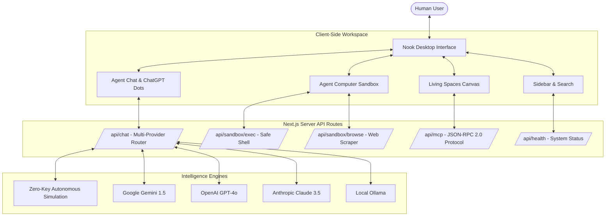

<div align="center">

# Nook ●
### Autonomous AI Coworkers with Persistent Computers & Living Spaces

[](LICENSE)
[](https://nextjs.org/)
[](https://react.dev/)
[](https://www.typescriptlang.org/)
[](https://modelcontextprotocol.io/)
[](CONTRIBUTING.md)

<p align="center">
  <b>An open-source sanctuary for persistent AI coworkers.</b><br/>
  Equipped with isolated computers (browser, shell & filesystem), collaborative living spaces, and human-in-the-loop review safeguards.<br/>
  <i>Inspired by <a href="https://github.com/CopilotKit/OpenDots">CopilotKit / OpenDots</a> and modern minimalist design systems.</i>
</p>

[Quickstart](#-quickstart) • [Architecture](#-architecture) • [Features](#-core-features) • [MCP Protocol](#-model-context-protocol-mcp) • [Roadmap](ROADMAP.md) • [Contributing](CONTRIBUTING.md)

</div>

---

## 🌟 Overview

**Nook** solves the limitation of disposable, stateless AI chat boxes. In Nook, you don't just prompt an ephemeral bot — you collaborate with **persistent specialist coworkers** who each own an isolated virtual computer:

```
┌────────────────────────────────────────────────────────────────────────┐
│                               NOOK OS                                  │
├───────────────────┬────────────────────────────────────────────────────┤
│  AI COWORKERS     │  ● Scout (Research)    ● Quill (Documentation)     │
│                   │  ● Cipher (DevOps)     ● Aura (Strategy)           │
├───────────────────┼────────────────────────────────────────────────────┤
│  AGENT COMPUTERS  │  🌐 Web Browser Scraper with Human Takeover        │
│                   │  💻 Safe Terminal Runner with Sandbox Filters      │
│                   │  📁 Virtual /workspace File Tree & Inline Editor   │
├───────────────────┼────────────────────────────────────────────────────┤
│  LIVING SPACES    │  📑 Notion/Linear Document Canvas (Editor/Preview) │
│                   │  ⚡ Interactive Slash Command Palette (/ Blocks)   │
├───────────────────┼────────────────────────────────────────────────────┤
│  GOVERNANCE       │  🛡️ Human-in-the-Loop Review Cards & Diff Previews │
│                   │  🔌 Model Context Protocol (MCP JSON-RPC 2.0)      │
│                   │  🎙️ Voice Sessions with Reactive Audio Waveforms   │
└───────────────────┴────────────────────────────────────────────────────┘
```

---

## 🏗️ Architecture

Nook is built on Next.js 16 (App Router), TypeScript, Tailwind CSS, and standard web APIs:



---

## ✨ Core Features

### 1. 🤖 Persistent Specialist Coworkers
- **Scout** 🧭 *(Deep Web Navigator)*: Navigates documentation, scrapes technical URLs, and synthesizes intelligence.
- **Quill** ✍️ *(Technical Writer)*: Transforms bullet points into clean, production-ready markdown pages in Spaces.
- **Cipher** ⚡ *(DevOps Engineer)*: Inspects codebases, runs terminal commands (`npm test`, `git status`), and edits `/workspace` files.
- **Aura** 👑 *(Strategist)*: Coordinates cross-space roadmaps and reviews project velocity.

### 2. 💻 Agent Computers (Sandboxed Environments)
- **Live Web Scraper (`/api/sandbox/browse`)**: Real-time server-side extraction of titles, metadata descriptions, semantic headings, and clean readable text.
- **Safe Shell Executor (`/api/sandbox/exec`)**: Command runner protected against destructive host execution (`rm -rf /`, `mkfs`, fork bombs).
- **Virtual Filesystem Explorer (`/workspace`)**: Direct file tree inspection, creation, inline code editing, syntax styling, and copy actions.
- **Human Takeover Mode**: Instantly switch control between the autonomous agent and manual human operation.

### 3. 📑 Living Spaces & Document Canvas
- **Tri-Mode View Switcher**: Effortlessly toggle between **Editor**, **Preview** (rendered markdown), and **Raw MD**.
- **Interactive Slash Command Palette**: Press `/` or click `/ Blocks` to insert headings, task checklists, code blocks, quote callouts, and tables.
- **Export & Portability**: Direct `.md` file download, copy-to-clipboard, and revision tracking.

### 4. 🛡️ Human-in-the-Loop Review Cards
- Mutating actions (saving pages to Spaces or executing shell commands) require human authorization.
- Review cards feature unified diff views, celebratory visual feedback upon approval, and decline feedback loops.

### 5. 🎙️ Voice Sessions with Reactive Equalizer
- Live voice call overlay with real-time waveform visualizer bars, spoken subtitles, and a floating Picture-in-Picture (PiP) mini-player.

### 6. 🎨 ChatGPT Dots & OpenDots Inspired Minimalist UI
- High-contrast, pure matte black-and-white aesthetic (`#0d0d0d`).
- Signature 3-dot breathing animation for thinking states.
- Clean floating prompt capsule with circular submit button.

---

## 🔌 Model Context Protocol (MCP)

Nook implements the **Model Context Protocol (MCP)** specification via a standard JSON-RPC 2.0 endpoint at `/api/mcp`:

### 1. List Available Tools (`tools/list`)
```bash
curl -X POST http://localhost:3000/api/mcp \
  -H "Content-Type: application/json" \
  -d '{"jsonrpc":"2.0","method":"tools/list","id":1}'
```

### 2. Execute an MCP Tool (`tools/call`)
```bash
curl -X POST http://localhost:3000/api/mcp \
  -H "Content-Type: application/json" \
  -d '{
    "jsonrpc": "2.0",
    "method": "tools/call",
    "params": {
      "name": "calculate",
      "arguments": { "expression": "2 * 3.14159 * 10" }
    },
    "id": 2
  }'
```

---

## 🚀 Quickstart

### Prerequisites
- **Node.js**: `v18.18+`, `v20+`, or `v24+` (Node 24 tested)
- **npm**: `v9+` (or pnpm / yarn / bun)

### 1. Clone & Install
```bash
git clone https://github.com/your-username/nook.git
cd nook
npm install
```

### 2. Configure Environment (Optional)
Nook works immediately out of the box in **Autonomous Demo Mode** with zero API keys. To connect real LLM providers:

```bash
cp .env.example .env.local
```

Populate your keys in `.env.local`:
```env
# Optional LLM API Keys
GEMINI_API_KEY=your_gemini_api_key
OPENAI_API_KEY=your_openai_api_key
ANTHROPIC_API_KEY=your_anthropic_api_key

# Optional Local Ollama
OLLAMA_BASE_URL=http://localhost:11434
OLLAMA_MODEL=llama3.2
```

### 3. Run Development Server
```bash
npm run dev
```

Open [http://localhost:3000](http://localhost:3000) (or `http://localhost:3001`) in your browser.

---

## 🧪 Testing & Verification

Nook uses the built-in Node.js test runner with TypeScript type-stripping (`node --test`):

```bash
# Run unit test suite
npm test

# Build production bundle
npm run build
```

---

## 📁 Repository Structure

```text
nook/
├── src/
│   ├── app/
│   │   ├── api/
│   │   │   ├── chat/route.ts           # Multi-provider LLM router
│   │   │   ├── health/route.ts         # Runtime system health check
│   │   │   ├── mcp/route.ts            # Model Context Protocol JSON-RPC 2.0
│   │   │   ├── sandbox/browse/route.ts # Web scraper & reader endpoint
│   │   │   └── sandbox/exec/route.ts   # Safe container command runner
│   │   ├── layout.tsx                  # Root layout & monochrome design tokens
│   │   ├── page.tsx                    # Primary state & view coordinator
│   │   └── globals.css                 # Minimalist styles & ChatGPT dots animations
│   ├── components/
│   │   ├── chat/                       # AgentChat & VoiceCallModal
│   │   ├── computer/                   # NookComputer (Browser, Terminal, Files)
│   │   ├── navigation/                 # Sidebar & Quick Search
│   │   ├── review/                     # ReviewCard (Human-in-the-Loop)
│   │   ├── spaces/                     # SpaceWorkspace, MarkdownViewer & SlashPalette
│   │   ├── tools/                      # McpManager
│   │   └── ui/                         # Toast Notifications
│   ├── lib/
│   │   ├── mcp-registry.ts             # Shared MCP tool definitions
│   │   ├── store.ts                    # Seed state (Agents, Spaces, Sandbox files)
│   │   └── llm-service.ts              # Agent reasoning & multi-turn executor
│   └── types/
│       └── index.ts                    # TypeScript domain definitions
├── .github/
│   ├── workflows/ci.yml                # Automated CI pipeline
│   ├── ISSUE_TEMPLATE/                 # Bug report & feature request templates
│   └── pull_request_template.md        # Standard PR review template
├── CHANGELOG.md                        # Version release notes
├── CITATION.cff                        # Academic research citation
├── CODE_OF_CONDUCT.md                  # Contributor Covenant Code of Conduct
├── CONTRIBUTING.md                     # Contribution guidelines & dev workflow
├── LICENSE                             # MIT License
├── ROADMAP.md                          # Upcoming releases and architectural milestones
├── package.json                        # Dependencies, metadata & scripts
└── tsconfig.json                       # TypeScript compiler options
```

---

## 🤝 Contributing

Contributions are warmly welcomed! Please read our [Contributing Guide](CONTRIBUTING.md) and [Code of Conduct](CODE_OF_CONDUCT.md) before opening a Pull Request.

1. Fork the repo and create your feature branch: `git checkout -b feat/my-new-feature`
2. Commit your changes: `git commit -m 'feat: add support for custom sandbox runtimes'`
3. Verify test suite passes: `npm test`
4. Push to your branch: `git push origin feat/my-new-feature`
5. Open a Pull Request!

---

## 📄 License

Distributed under the **MIT License**. See [`LICENSE`](LICENSE) for more details.

---

<div align="center">
  <b>Built with care for open-source AI developer communities.</b><br/>
  Star ⭐ this repo if you find Nook inspiring!
</div>
