<div align="center">

# Nook ●
### Autonomous AI Coworkers with Persistent Computers & Living Spaces

[](LICENSE)
[](https://nextjs.org/)
[](https://react.dev/)
[](https://www.typescriptlang.org/)
[](https://nodejs.org/)
[](https://modelcontextprotocol.io/)
[](README.md)
[](CONTRIBUTING.md)

<p align="center">
  <b>A self-hosted, single-user workspace for persistent AI coworkers.</b><br/>
  Featuring dedicated execution sandboxes, server-side approval gates, durable SQLite state, living spaces, and Model Context Protocol (MCP) tool calling.<br/>
  <i>Developed through human-directed, AI-assisted "vibe coding" with high craft and rigorous security remediation.</i>
</p>

[Quickstart](#-quickstart) • [Architecture](#-architecture) • [Security & Isolation](#-security--isolation-model) • [Feature Matrix](#-feature-matrix--status) • [Roadmap](ROADMAP.md) • [Contributing](CONTRIBUTING.md)

</div>

---

> [!NOTE]
> **✨ Methodology Disclosure**: Nook was created and developed through human-directed AI-assisted development ("vibe coding"). Every subsystem has undergone technical auditing, security remediation, and verification across authentication, server approvals, isolation boundaries, SSRF prevention, and transactional persistence.

## 🌟 Overview

**Nook** provides a dedicated, single-user operating environment for AI coworkers. Rather than disposable, stateless chat threads, Nook pairs each coworker with:
- **Persistent Persona & Role**: Scout (Research), Quill (Technical Writing), Cipher (DevOps & Code), and Aura (Architecture & Strategy).
- **Persistent Missions & Objectives**: Multi-milestone goals with dependency scheduling, autonomous coworker delegation, and verifiable progress.
- **Immutable Evidence Engine**: Every agent action creates an inspectable execution record with tool inputs, citations, command exit codes, and output artifacts.
- **Agent Computer**: An execution environment with shell execution, file synchronization, and web browsing.
- **Living Spaces**: Markdown canvas with version tracking, immutable revision logs, full-text search, and document rollbacks.
- **Server-Side Governance**: Human-in-the-loop review cards requiring cryptographic single-use approvals before executing mutating actions.
- **100% Sovereign & Self-Hostable**: Complete offline-first execution with local Ollama model integration and full workspace export/import.

---

## 🏗️ Architecture

```mermaid
graph TD
  User([Authenticated Single User]) <-->|Session Cookie / HMAC| Gateway[Next.js App & Security Middleware]
  
  subgraph Frontend [Client Workspace]
    Gateway <--> UI[Nook Desktop Interface]
    UI <--> Chat[Coworker Chat & Review Cards]
    UI <--> Missions[Missions & Milestone Tracker]
    UI <--> Spaces[Living Spaces Editor & Revisions]
    UI <--> Computer[Agent Computer Modal]
  end

  subgraph BackendEngine [Security & Execution Services]
    Gateway <--> AuthRoute[/api/auth/session - HMAC Auth/]
    Gateway <--> MissionRoute[/api/missions - Aura Orchestrator/]
    Gateway <--> EvidenceRoute[/api/missions/evidence - Evidence Engine/]
    Gateway <--> ApprRoute[/api/approvals - Atomic Single-Use Approvals/]
    Gateway <--> ExecRoute[/api/sandbox/exec - Isolated Shell Runner/]
    Gateway <--> BrowseRoute[/api/sandbox/browse - SSRF-Protected Fetch/]
    Gateway <--> MCPRoute[/api/mcp - MCP JSON-RPC 2.0 Server/]
    Gateway <--> JobsRoute[/api/jobs - Durable Background Queue/]
    Gateway <--> SearchRoute[/api/workspace/search - FTS Workspace Search/]
    Gateway <--> ExportRoute[/api/workspace/export - Sovereign Data Backup/]
    Gateway <--> ChatRoute[/api/chat - Multi-Model Router/]
  end

  subgraph StorageEngine [Transactional Storage & Security Vault]
    BackendEngine <--> SQLite[(Node 24 SQLite WAL Database)]
    BackendEngine <--> Vault[AES-256-GCM Encrypted Secrets Vault]
    BackendEngine <--> Sandboxes[Agent Sandboxes .nook_sandboxes/]
  end
```



---

## 🛡️ Security & Isolation Model

Security and correctness take strict precedence over release claims or cosmetic features:

1. **Authentication & Session Security**:
   - Cryptographically signed HMAC-SHA256 session tokens (`<sessionId>.<expiry>.<hmacSignature>`).
   - Secure `HttpOnly`, `SameSite=Lax` cookies with strict CSRF origin verification on mutating requests.
   - Sliding-window in-memory rate limiting and request body payload limits (5MB max).
   - Fails closed on missing or unauthorized access.

2. **Server-Side Approval Gates**:
   - Every mutating terminal execution requires an explicit server-side approval record.
   - Enforces exact command and agent binding: an approval for command `A` cannot authorize command `B`.
   - Atomic single-use token consumption preventing replay attacks and race conditions.
   - Reusable authorization tokens are redacted from general API listings.

3. **Filesystem & Execution Isolation**:
   - Per-agent isolated sandboxes (`.nook_sandboxes/<agentId>`).
   - Rejection of path traversal (`../`, absolute paths, null bytes) during file synchronization.
   - Host secrets and provider API keys are stripped from execution child process environments.
   - Destructive commands (`rm -rf /`, fork bombs, mkfs) are blocked before execution.

4. **Centralized SSRF Defense Engine**:
   - Comprehensive outbound URL validator blocking IPv4/IPv6 private ranges (`127.0.0.0/8`, `10.0.0.0/8`, `172.16.0.0/12`, `192.168.0.0/16`, `169.254.169.254` cloud metadata, `::1`, link-local).
   - DNS pre-resolution and hop-by-hop revalidation on HTTP redirects (max 5 hops).
   - Stream byte limits (max 2MB) to prevent buffer exhaustion.

5. **Encrypted Secrets Vault**:
   - Provider API keys stored on server disk encrypted with AES-256-GCM using keys derived from the master secret.
   - Client bodies cannot override server-configured keys.
   - Raw secrets are never exposed in workspace state exports, logs, or UI responses.

---

## 📊 Feature Matrix & Status

| Subsystem | Implementation Status | Verification Details |
| :--- | :--- | :--- |
| **Authentication & Sessions** | **Implemented & Verified** | HMAC-SHA256 tokens, HttpOnly cookies, CSRF protection, fails closed. |
| **Server-Side Approvals** | **Implemented & Verified** | Atomic SQLite transitions, single-use tokens, exact command matching. |
| **Filesystem & Path Traversal Guard** | **Implemented & Verified** | `path.resolve` containment checks, sanitized basenames, size limits. |
| **SSRF Defense Engine** | **Implemented & Verified** | Blocks loopback, cloud metadata, private CIDRs, DNS rebinding. |
| **Encrypted Secrets Vault** | **Implemented & Verified** | AES-256-GCM encryption with 0600 file permissions and masked UI display. |
| **Aura Central Orchestrator** | **Implemented & Verified** | Multi-agent objective decomposition, milestone dependency trees, task delegation. |
| **Persistent Missions Engine** | **Implemented & Verified** | SQLite WAL schema, status lifecycles, and persistent multi-session recovery. |
| **Immutable Evidence Engine** | **Implemented & Verified** | Inspectable timeline of tool inputs, source citations, exit codes, diffs & report export. |
| **Sovereign Local Self-Hostability** | **Implemented & Verified** | Zero-cloud deployment with Ollama, full workspace export/import without plaintext secrets. |
| **Plugin & Extension System** | **Implemented & Verified** | Versioned manifests, JSON-RPC tools, per-agent permissions, execution timeouts. |
| **Knowledge Workspace Search** | **Implemented & Verified** | High-performance SQLite full-text search across spaces, documents, excerpts, and tags. |
| **Model Provider Router** | **Implemented & Verified** | Gemini, OpenAI, Claude, local Ollama; fails loud with HTTP 502 on provider errors. |
| **Model Context Protocol (MCP)** | **Implemented & Verified** | JSON-RPC 2.0 (`web_search`, `fetch_url`, `calculate`, `format_document`). |
| **Living Spaces Persistence** | **Implemented & Verified** | SQLite WAL engine, version increments (`v1`...`vN`), immutable revisions, rollback. |
| **Background Worker Queue** | **Implemented & Verified** | Database-backed atomic leases with fencing, queue claiming, crash recovery. |
| **Terminal Execution** | **Implemented & Verified** | Dedicated per-task container/process jail with short-lived HMAC tickets, zero host socket exposure, and fail-closed security. |
| **Browser State & Snapshots** | **Implemented & Verified** | Authentic Playwright browser captures, interactive DOM sessions, SSRF-pinned egress, and honest placeholder distinction. |
| **Voice Calls** | **Simulation** | UI demonstration with reactive Web Audio API waveforms and captions. |

---

## 🔬 Architectural Evaluations & Demonstrations

Nook provides transparent, reproducible engineering evaluations:

- **Technical Architecture Comparison**: See [`docs/competitive/OPENDOTS_COMPARISON.md`](docs/competitive/OPENDOTS_COMPARISON.md) for detailed evaluation across 17 architectural categories.
- **Automated Validation Suite**: Comprehensive test suite covering authentication, database leases, fail-closed isolation, structured TAP/node:test verifiers, and PBKDF2 secrets derivation.
- **Verified End-to-End Demonstrations**: See [`docs/demonstrations/DEMONSTRATIONS.md`](docs/demonstrations/DEMONSTRATIONS.md) covering autonomous research, sandbox testing, multi-agent collaboration, and persistent crash recovery.
- **Sovereign Self-Hosting Guide**: See [`docs/deployment/SELF_HOSTED_GUIDE.md`](docs/deployment/SELF_HOSTED_GUIDE.md) for step-by-step local setup with Ollama.
- **Plugin Developer Guide**: See [`docs/plugins/DEVELOPER_GUIDE.md`](docs/plugins/DEVELOPER_GUIDE.md) for creating custom tools.

---

## 🚀 Quickstart

### Prerequisites
- **Node.js**: `v24.x LTS` (Node 24 is standardized across development, CI, and Docker)
- **npm**: `v10.x` or higher

### Local Installation

```bash
# 1. Clone repository
git clone https://github.com/BilalSabugar/Nook.git
cd Nook

# 2. Clean install dependencies
npm ci

# 3. Run validation checks
npm test               # Runs 45+ unit & integration security tests
npm run typecheck      # Verifies TypeScript types with zero errors
npm run lint           # Runs ESLint checks
npm run build          # Builds production bundle

# 4. Start development server
npm run dev
```

Open [http://localhost:3000](http://localhost:3000) in your browser.

### Docker Deployment

```bash
# Run with Docker Compose
docker compose up -d --build

# View container status and healthcheck
docker compose ps
```

The container runs as non-root user `nextjs:nodejs` on port 3000 with persistent storage mounted to volume `nook_data`.

---

## 🧪 Testing & Verification

Nook includes an extensive test suite covering security, approvals, isolation, and persistence:

```bash
npm test
```

Key verified test suites (45 tests passing):
- `Auth: Anonymous and invalid token requests are strictly denied`
- `Auth: Legitimate cryptographic session tokens succeed`
- `Approvals: Shell execution without approval is rejected`
- `Approvals: Full lifecycle, exact command matching, single-use, and replay protection`
- `Approvals: Expired authorization tokens are rejected`
- `SSRF: Outbound URL validator strictly blocks internal/private targets`
- `Living Spaces: Document revision tracking and version rollback`
- `Background Worker: Queue claiming, genuine step execution, and cancellation`
- `Secrets: AES-256-GCM encryption, decryption, masking, and model whitelisting`
- `Browser Screenshots: Distinguishes authentic Playwright captures from synthetic fallbacks with honest metadata`
- `Sandbox Tickets: Validates action-bound HMAC tickets and rejects tampered, replayed, or expired requests`
- `Missions: Atomic SQLite leases prevent concurrent ticks and enforce fencing`
- `Mission State Control: Pause, resume, and cancel enforce atomic worker lease fencing`
- `Background Worker: Research jobs fail closed when zero verified citations are retrieved`
- `Solution Planner: Dynamic synthesis produces genuine requirement-driven code for arbitrary prompts`
- `Runner Safety: validateCommandSafety independently rejects traversal and destructive commands`

---

## 📄 License

This project is licensed under the [MIT License](LICENSE).
